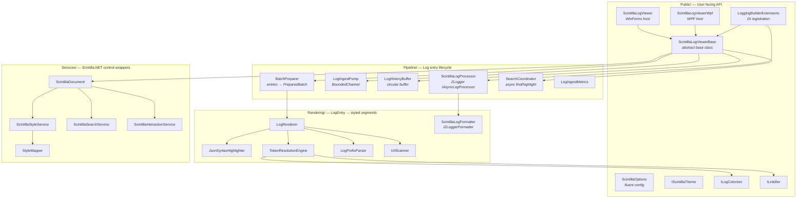
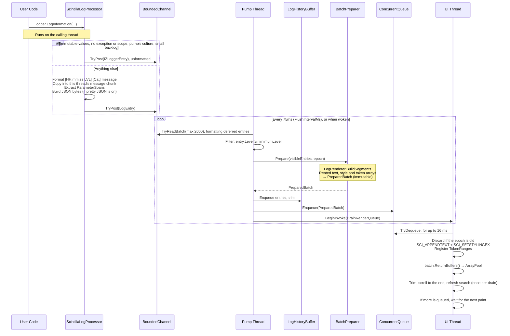
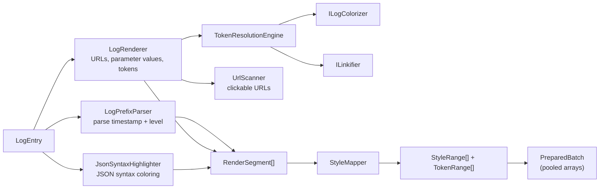
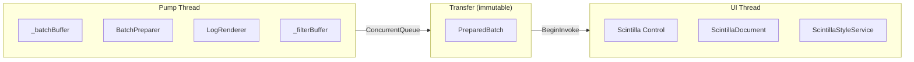
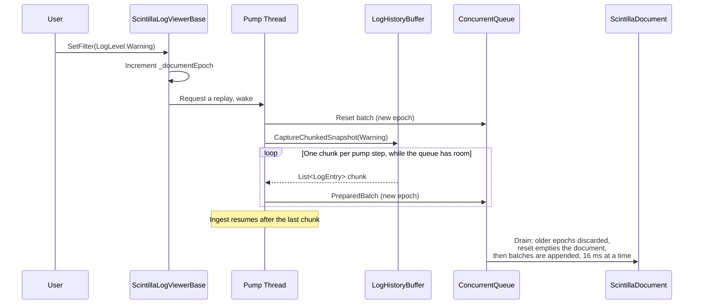
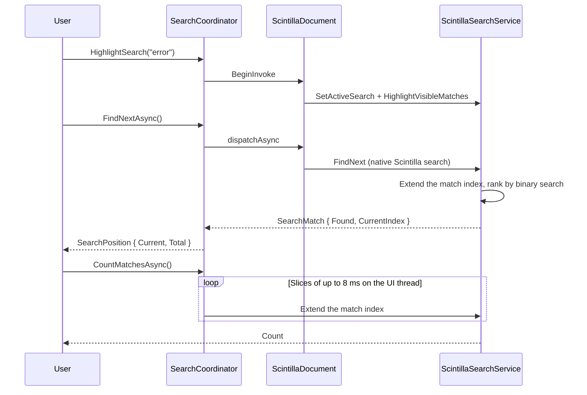
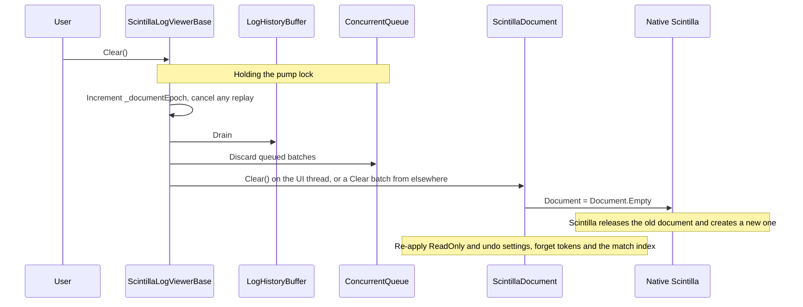
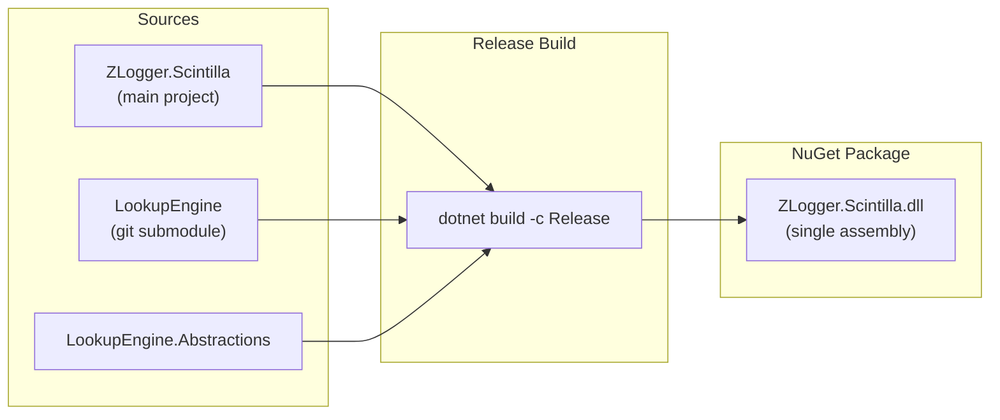

# Architecture

ZLogger.Scintilla is an in-process log viewer built on [Scintilla.NET](https://github.com/VPKSoft/Scintilla.NET) and [ZLogger](https://github.com/Cysharp/ZLogger). It renders structured log entries with semantic syntax highlighting, clickable links, JSON pretty-printing, and real-time search/filter.

This page describes the current code. For its open limits, see [known-issues.md](known-issues.md).

## Design Principles

- **Three-stage pipeline** — the calling thread formats each message into UTF-8 and builds its parameter metadata, the pump thread builds segments and styles, and the UI thread only calls Scintilla APIs. The log call does not wait for the UI, but it does pay for formatting
- **One owner for pipeline state** — the channel reader, the history, the preparer and the renderer belong to the pump, and everything that touches them holds its lock. A filter change asks the pump to replay, so replay and ingest are ordered
- **Batch hand-off** — an immutable `PreparedBatch` carries each batch from the pump to the UI thread and shares nothing with its entries. Each carries a document epoch, and the UI discards one from an older epoch
- **Bounded everywhere** — at most 8 prepared batches wait for the UI. Past that the pump stops reading, the channel fills, and its drop policy applies
- **The UI thread stays free** — a drain stops after 16 ms, and the next one waits for the next paint, because Windows delivers posted messages ahead of input and paint
- **Bytes only** — Scintilla positions are bytes. Everything talks to it through `SCI_*` messages in bytes, because the ScintillaNET wrappers use UTF-16 positions
- **ZLogger's cost on the logging thread when it can be** — a message holding only immutable values is formatted on the pump, as ZLogger's design intends. A value that may be mutable or tied to its thread is formatted where it was logged, and so is everything once 4,096 entries are waiting, because ZLogger's pools keep every entry that was ever waiting at once
- **ArrayPool everywhere on the batch path, not zero-allocation** — `byte[]`, `StyleRange[]`, `TokenRange[]` are rented and returned after UI application. Each entry still allocates a `LogEntry` and its text, packed into a chunk owned by the logging thread
- **Narrow public surface** — only 3 interfaces for user implementation: `IScintillaTheme`, `ILogColorizer`, `ILinkifier`

---

## Component Map



---

## Log Entry Pipeline



A message is prepared before history can trim, because trimming a batch larger than the history would otherwise release entries that were still about to be read.

**The flush interval** only batches lines that arrive close together. After a quiet interval, the next line wakes the pump, so a single line appears at once.

**Trimming** goes in steps of a tenth of the document while logs keep arriving, and returns to exactly `MaxLines` when they pause. Scintilla remembers the lines waiting for word wrap as one range, so a trim at the start plus an append at the end queues the whole document to be wrapped again.

**Lines that cannot be seen** are not rendered. If the lines still waiting in the channel will fill the document on their own, the batch is skipped, and a deferred entry is not even formatted if the history would drop it too. This applies only when those waiting lines are certain to arrive, so not under a filter or a drop policy that removes queued entries.

**Word wrap** stays on. Scintilla measures a wrapped line only when it lays that line out, so the document grows as lines come into view. `SCI_SCROLLTOEND` alone would stop short, so each paint checks the position and scrolls again if the view still follows the tail.

**Following the tail** stops when the user moves away from the end, and only input tells them apart. `LogScintillaControl` reports `WM_VSCROLL`, `WM_MOUSEWHEEL` and `WM_KEYDOWN`, because Scintilla's own notifications look the same for scrolling by the user, by the viewer, and by wrapping.

---

## Rendering Pipeline



---

## Thread Ownership



| Data | Owner | Notes |
|------|-------|-------|
| `_batchBuffer`, `_filterBuffer` | Pump thread | Never crosses boundary |
| `BatchPreparer`, `LogRenderer` | Pump thread | One instance each, used by ingest and replay in turn |
| Channel reader, `LogHistoryBuffer` | Pump lock | `Clear()` and `Dispose()` take the same lock |
| `PreparedBatch` | Transfer | Created on pump, consumed on UI, returned to pool |
| Scintilla control | UI thread | All `SCI_*` calls happen here |
| `ILogColorizer` / `ILinkifier` | Pump thread, outside the pump lock | Implementations **must** be thread-safe. They may wait for the UI thread: `Clear()` does not wait for them, and `Stop()` on the UI thread returns without waiting for the pump |

---

## Filter Flow



Batches prepared before the request carry the old epoch, so the UI discards them. Their entries are already in the history, so the replay includes them. A newer `SetFilter` restarts the replay. With history disabled there is nothing to rebuild from, so the filter applies to new lines and the document stays as it is.

**Threshold semantics:** `entry.Level >= minimumLevel`

| `SetFilter(level)` | Entries shown |
|---------------------|---------------|
| `LogLevel.Trace` | All |
| `LogLevel.Warning` | Warning, Error, Critical |
| `LogLevel.None` | Nothing |

---

## Search Flow



Navigation, highlighting and counting use Scintilla's own search with the same flags, so they always agree. The match index survives new log lines, which only add to the end, and head trims, which shift its positions by a stored offset, so a rank costs at most one scan of the new text.

Search refresh is lazy: `RefreshHighlightIfActive` runs once per `DrainRenderQueue` cycle, not per batch.

---

## Project Structure

```
ZLogger.Scintilla/
├── Models/          Data structs, value types, constants
├── Public/          User-facing API (base class, interfaces, DI, themes, options)
├── Pipeline/        Log lifecycle: ingest → filter → prepare → UI dispatch
├── Rendering/       LogEntry → styled byte segments (formatter, highlighters, parsers)
└── Services/        Direct Scintilla.NET control wrappers
```

### Models/ — 13 files

| File | Role |
|------|------|
| `LogEntry` | In-memory log entry. Its text is a slice of a chunk shared with the messages logged around it |
| `PreparedBatch` + `PooledSegment<T>` | Immutable transfer: text + styles + tokens (pooled) |
| `RenderContext` | Message bytes + properties for `ILinkifier`/`ILogColorizer` |
| `RenderSegment` | `{ Utf8Length, SemanticStyle, TokenPayload, IsLink }` |
| `SemanticStyle` | Enum + style ID mapping |
| `StyleRange`, `TokenRange`, `TokenPayload` | Scintilla styling primitives |
| `ParameterSpan` | Typed parameter metadata + `IsLeafType()` classification |
| `ParsedPrefix`, `SearchPosition`, `SearchMatch` | Small value types |
| `LogConstants` | SCI message IDs, capacities, property keys |

### Public/ — 10 files

| File | Role |
|------|------|
| `ScintillaLogViewerBase` | Abstract base — pump loop, filter, history, search, metrics |
| `ScintillaLogViewer` | WinForms `UserControl` host |
| `ScintillaLogViewerWpf` | WPF `WindowsFormsHost` wrapper |
| `ScintillaOptions` | Fluent startup configuration |
| `LoggingBuilderExtensions` | `AddZLoggerScintillaWinForms` / `Wpf` |
| `IScintillaTheme`, `ILogColorizer`, `ILinkifier` | Extension point contracts |
| `ScintillaThemes` | Built-in Dark / Light themes |

### Pipeline/ — 7 files

| File | Role |
|------|------|
| `ScintillaLogProcessor` | ZLogger `IAsyncLogProcessor` entry point |
| `LogIngestPump` | `BoundedChannel<LogEntry>` producer/consumer |
| `LogHistoryBuffer` | Circular buffer; chunked snapshot for filter reapply |
| `BatchPreparer` | Off-thread: entries → `PreparedBatch` (pooled arrays) |
| `SearchCoordinator` | Async find/highlight dispatch |
| `LogIngestMetrics` | Rendered / dropped / backlog counters |
| `ThreadBufferCache` | Per-thread scratch buffers that leave the cache while in use, so a nested log call cannot overwrite them |

### Rendering/ — 7 files

| File | Role |
|------|------|
| `LogRenderer` | One path for every message, on UTF-8 text: URLs, then parameter values, then tokens |
| `ScintillaLogFormatter` | `IZLoggerFormatter`: `[HH:mm:ss LVL] [Cat] {msg}` (configurable timestamp) |
| `JsonSyntaxHighlighter` | JSON syntax coloring (no serialization) |
| `TokenResolutionEngine` | Try `ILinkifier` then `ILogColorizer` per token |
| `LogPrefixParser` | Parse `[HH:mm:ss LVL] [Cat]` prefix |
| `UrlScanner` | URL detection in UTF-8 text + linkification |
| `RenderingChars` | Byte classification helpers |

### Services/ — 7 files

| File | Role |
|------|------|
| `ScintillaDocument` | UI thread: apply `PreparedBatch` → Scintilla, trim, follow the tail |
| `LogScintillaControl` | Scintilla control that reports scrolling done by the user |
| `ScintillaStyleService` | `SCI_SETSTYLINGEX`, dynamic style allocation |
| `ScintillaSearchService` | Find, highlight, match position cache |
| `ScintillaInteractionService` | Click/hover → invoke link `Action` |
| `StyleMapper` | `RenderSegment[]` → `StyleRange[]` |
| `NativeWindowsHelper` | Win32 dark mode |

---

## Clear / Memory Release

When `Clear()` is called on the viewer, the pipeline releases its entries and swaps the document:



Lines logged after `Clear()` returns stay in the document: off the UI thread, the document is cleared in queue order, so `Clear()` returns before that happens.

Private memory stays high right after `Clear()`, because the entries have not been collected yet. A run holding 50k messages was about 25-35 MB over baseline right after `Clear()`, and within about 4 MB after a full GC. `MemoryProbe` asserts that this memory can be reclaimed. The library does not force a collection, which is the application's call.

---

## Build & Packaging



- **LookupEngine** is a git submodule at `external/LookupEngine` — provides object decomposition for pretty JSON
- Its source files compile directly into `ZLogger.Scintilla.dll`, so Debug and Release builds are the same shape. Merging separately built assemblies would bring one more copy of the Polyfill and JetBrains.Annotations source packages per assembly, renamed with random GUIDs, and no Polyfill option can prevent that because each copy is compiled before the merge
- The NuGet package ships a **single assembly** with no external LookupEngine dependency
- LookupEngine's public types remain public
- `System.Text.Json` is a declared package dependency on `net48`, because LookupEngine needs a newer version than ZLogger asks for
- Scintilla5.NET keeps its build assets (`PrivateAssets="none"`), because its build target is what delivers the native DLLs to `net48` applications
- Polyfill is net48-only and internal, with `PolyUseEmbeddedAttribute` so that `InternalsVisibleTo` does not expose it
