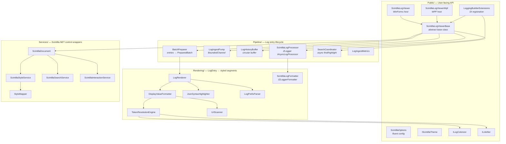
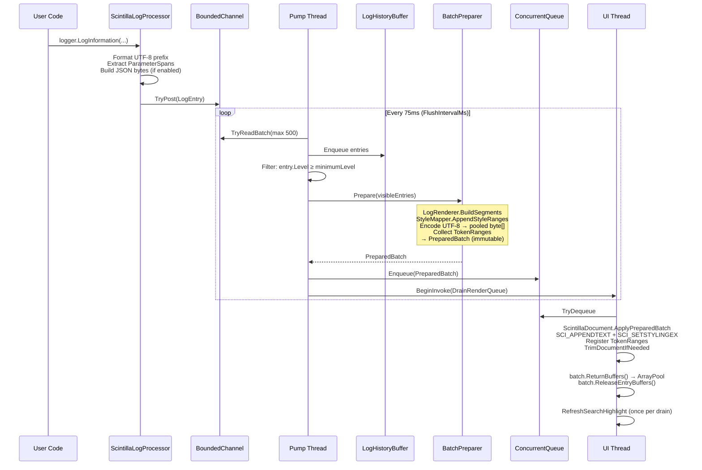
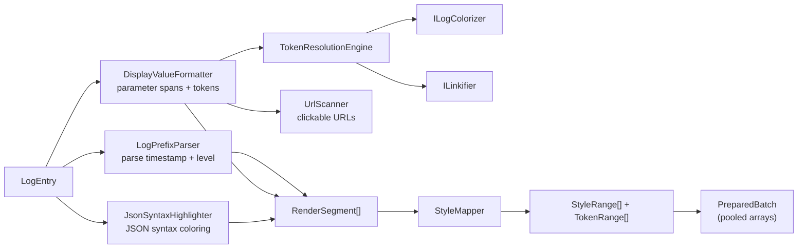
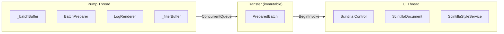
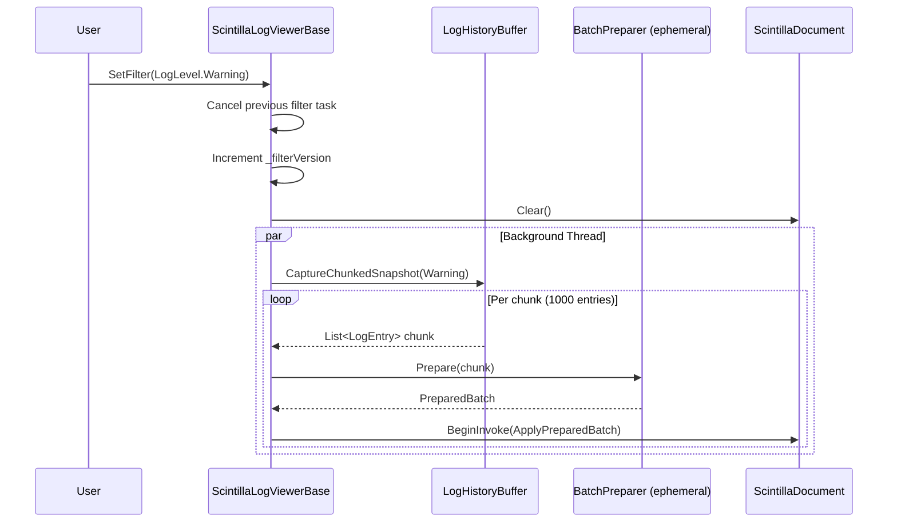
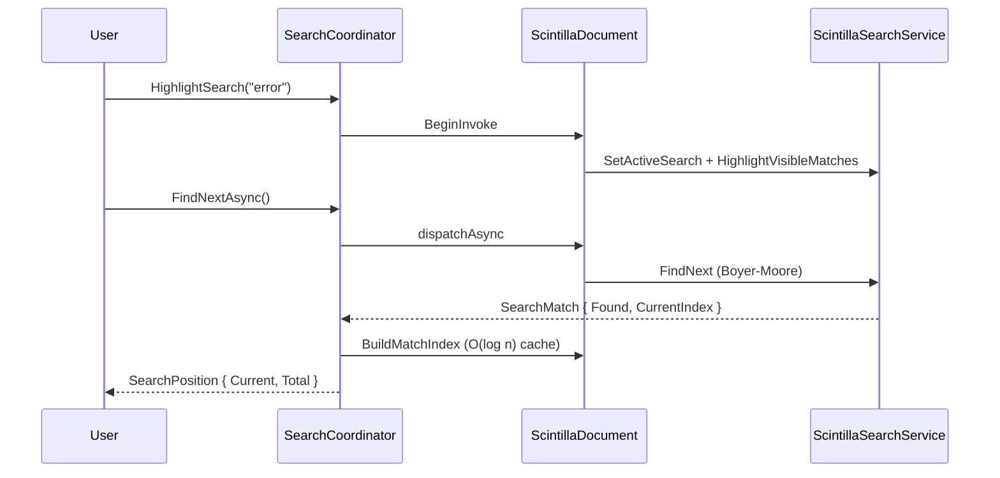

# Architecture

ZLogger.Scintilla is a high-throughput, in-process log viewer built on [Scintilla.NET](https://github.com/VPKSoft/Scintilla.NET) and [ZLogger](https://github.com/Cysharp/ZLogger). It renders structured log entries with semantic syntax highlighting, clickable links, JSON pretty-printing, and real-time search/filter — without blocking the logging thread.

## Design Principles

- **Prepare off-thread, apply on-thread** — formatting, segment building, and style computation happen on the pump thread; the UI thread only calls Scintilla APIs
- **Zero shared mutable state** — `PreparedBatch` is an immutable transfer object; no `List<T>` crosses thread boundaries
- **ArrayPool everywhere** — `byte[]`, `StyleRange[]`, `TokenRange[]` are rented and returned after UI application
- **Narrow public surface** — only 3 interfaces for user implementation: `IScintillaTheme`, `ILogColorizer`, `ILinkifier`

---

## Component Map



---

## Log Entry Pipeline



---

## Rendering Pipeline



---

## Thread Ownership



| Data | Owner | Notes |
|------|-------|-------|
| `_batchBuffer`, `_filterBuffer` | Pump thread | Never crosses boundary |
| `BatchPreparer` scratch buffers | Pump thread | Ephemeral per replay |
| `PreparedBatch` | Transfer | Created on pump, consumed on UI, returned to pool |
| Scintilla control | UI thread | All `SCI_*` calls happen here |
| `ILogColorizer` / `ILinkifier` | Pump thread | Implementations **must** be thread-safe |

---

## Filter Flow



**Threshold semantics:** `entry.Level >= minimumLevel`

| `SetFilter(level)` | Entries shown |
|---------------------|---------------|
| `LogLevel.Trace` | All |
| `LogLevel.Warning` | Warning, Error, Critical |
| `LogLevel.None` | Nothing |

---

## Search Flow



Search refresh is lazy: `RefreshHighlightIfActive` runs once per `DrainRenderQueue` cycle, not per batch.

---

## Project Structure

```
ZLogger.Scintilla/
├── Models/          Data structs, value types, constants
├── Public/          User-facing API (base class, interfaces, DI, themes, options)
├── Pipeline/        Log lifecycle: ingest → filter → prepare → UI dispatch
├── Rendering/       LogEntry → styled byte segments (formatter, highlighters, parsers)
└── Services/        Direct Scintilla.NET control wrappers
```

### Models/ — 13 files

| File | Role |
|------|------|
| `LogEntry` | In-memory log entry with pooled `byte[]` |
| `PreparedBatch` + `PooledSegment<T>` | Immutable transfer: text + styles + tokens (pooled) |
| `RenderContext` | Message bytes + properties for `ILinkifier`/`ILogColorizer` |
| `RenderSegment` | `{ Utf8Length, SemanticStyle, TokenPayload, IsLink }` |
| `SemanticStyle` | Enum + style ID mapping |
| `StyleRange`, `TokenRange`, `TokenPayload` | Scintilla styling primitives |
| `ParameterSpan` | Typed parameter metadata + `IsLeafType()` classification |
| `ParsedPrefix`, `SearchPosition`, `SearchMatch` | Small value types |
| `LogConstants` | SCI message IDs, capacities, property keys |

### Public/ — 9 files

| File | Role |
|------|------|
| `ScintillaLogViewerBase` | Abstract base — pump loop, filter, history, search, metrics |
| `ScintillaLogViewer` | WinForms `UserControl` host |
| `ScintillaLogViewerWpf` | WPF `WindowsFormsHost` wrapper |
| `ScintillaOptions` | Fluent startup configuration |
| `LoggingBuilderExtensions` | `AddZLoggerScintillaWinForms` / `Wpf` |
| `IScintillaTheme`, `ILogColorizer`, `ILinkifier` | Extension point contracts |
| `ScintillaThemes` | Built-in Dark / Light themes |

### Pipeline/ — 6 files

| File | Role |
|------|------|
| `ScintillaLogProcessor` | ZLogger `IAsyncLogProcessor` entry point |
| `LogIngestPump` | `BoundedChannel<LogEntry>` producer/consumer |
| `LogHistoryBuffer` | Circular buffer; chunked snapshot for filter reapply |
| `BatchPreparer` | Off-thread: entries → `PreparedBatch` (pooled arrays) |
| `SearchCoordinator` | Async find/highlight dispatch |
| `LogIngestMetrics` | Rendered / dropped / backlog counters |

### Rendering/ — 9 files

| File | Role |
|------|------|
| `LogRenderer` | Orchestrator: `BuildSegments`, `BuildJsonSegments`, `ApplyThemeStyles` |
| `ScintillaLogFormatter` | `IZLoggerFormatter`: `[HH:mm:ss.fff LVL] [Cat] {msg}` |
| `DisplayValueFormatter` | Parameter span styling + linkifier/colorizer per token |
| `JsonSyntaxHighlighter` | JSON syntax coloring (no serialization) |
| `TokenResolutionEngine` | Try `ILinkifier` then `ILogColorizer` per token |
| `LogPrefixParser` | Parse `[HH:mm:ss.fff LVL] [Cat]` prefix |
| `UrlScanner` | URL/email detection + linkification |
| `RenderingChars` | Shared char sets and classification helpers |
| `RenderTokenWriter` | Segment writer helper |

### Services/ — 6 files

| File | Role |
|------|------|
| `ScintillaDocument` | UI thread: apply `PreparedBatch` → Scintilla |
| `ScintillaStyleService` | `SCI_SETSTYLINGEX`, dynamic style allocation |
| `ScintillaSearchService` | Find, highlight, match position cache |
| `ScintillaInteractionService` | Click/hover → invoke link `Action` |
| `StyleMapper` | `RenderSegment[]` → `StyleRange[]` |
| `NativeWindowsHelper` | Win32 dark mode |
