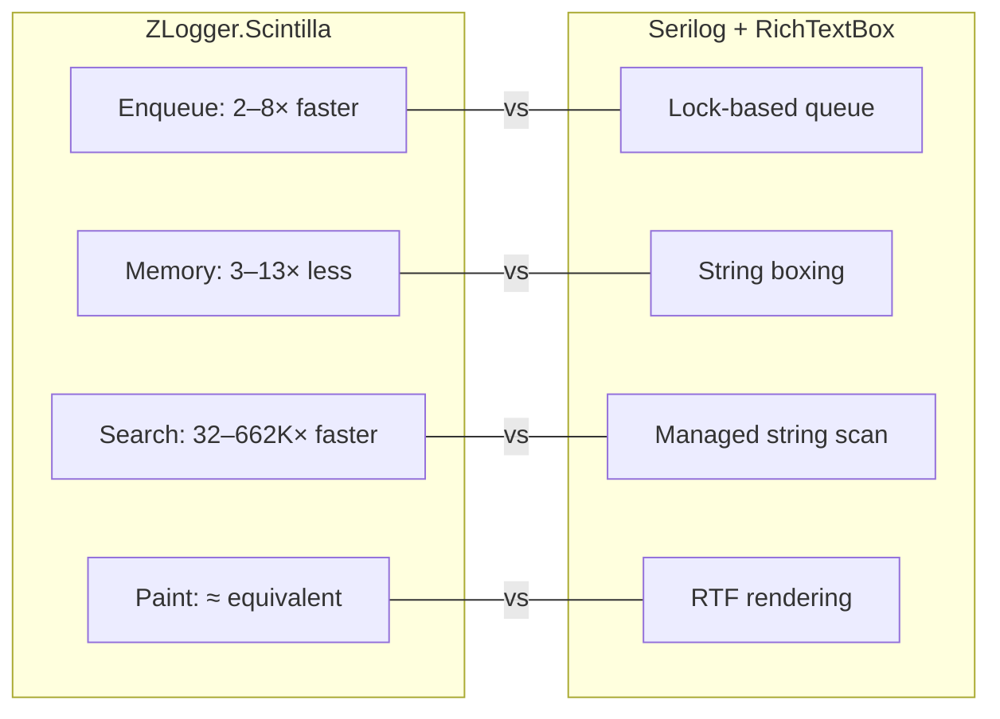

# Benchmarks

Benchmarks live in `ZLogger.Scintilla.Benchmarks/` and use [BenchmarkDotNet](https://benchmarkdotnet.org/).

**Environment:** Intel Core Ultra 7 265K 3.90GHz · .NET 8.0.25 · Windows 11 25H2

---

## Performance Summary



---

## Running Benchmarks

```bash
dotnet run -c Release --project ZLogger.Scintilla.Benchmarks -- --filter *
dotnet run -c Release --project ZLogger.Scintilla.Benchmarks -- --filter *IngestThroughput*
dotnet run -c Release --project ZLogger.Scintilla.Benchmarks -- --list flat
```

Results are written to `BenchmarkDotNet.Artifacts/results/`.

---

## Benchmark Groups

Every benchmark class runs in two comparison groups:

| Group | Serilog Config | Scintilla Config | Purpose |
|-------|---------------|------------------|---------|
| **Production** | Real `RichTextBoxSink`, 2048-line cap | 50k lines, history enabled | Real-world production behavior |
| **Uncapped** | Wrapper bypassing cap (50k lines via reflection) | 50k lines, history enabled | Fair same-volume comparison |

Each group also splits measurements into two phases:

| Phase | What it measures |
|-------|-----------------|
| `*_Enqueue` | Time to push all messages into the pipeline only — no waiting for render. Fair producer-side comparison. |
| `*_FullPipeline` / `*_Drain` | Time for full cycle: enqueue + render completion. Measures end-to-end latency. |

---

## Benchmark Classes

| Class | What It Measures | Volume |
|-------|-----------------|--------|
| `IngestThroughputBenchmark` | 4 concurrent producers pushing messages; enqueue phase vs drain phase | 50k messages |
| `ColorizedRenderBenchmark` | Full pipeline: ingest → colorize → pixel paint | 2k structured JSON |
| `LargeDocumentSearchBenchmark` | `HighlightSearch` + `FindNext` on pre-filled document | 50k pre-filled lines |
| `FilterReapplyBenchmark` | `SetFilter(Warning)` reapply from history vs Serilog re-emit | 50k history entries |
| `PaintBenchmark` | Isolated `WM_PRINTCLIENT` pixel-draw cost | 5k pre-filled lines |
| `SustainedLoadBenchmark` | Continuous load — enqueue throughput + memory pressure | 100k messages |

---

## Data: Realistic Mixed

All benchmarks use `ScenarioDataFactory.BuildRealisticMixed()`:

| Property | Value |
|----------|-------|
| Level distribution | Trace 10%, Debug 20%, Info 40%, Warning 20%, Error 8%, Critical 2% |
| Message size | 64–2048 bytes, mean ~256 |
| Content mix | 60% plain text, 30% structured JSON, 10% exception stack traces |
| Reproducibility | Deterministic via seed — same results across runs |

---

## Results (Intel Core Ultra 7 265K · .NET 8.0.25)

### IngestThroughputBenchmark — 50k messages, 4 producers

#### Enqueue phase (producer-side, fair comparison)

| | Scintilla | Serilog+RTB | Ratio |
|---|---|---|---|
| Production enqueue | **5.9 ms** | 12.3 ms | **2.1× faster** |
| Uncapped enqueue | **6.5 ms** | 19.0 ms | **2.9× faster** |
| Production alloc | **4.99 MB** | 17.17 MB | **3.4× less** |
| Uncapped alloc | **4.96 MB** | 30.91 MB | **6.2× less** |

`BoundedChannel.TryWrite` (lock-free) vs `ConcurrentCircularBuffer.Add` (lock-based). Allocation difference from `ArrayPool<byte>` vs string boxing.

#### Drain phase (render-thread latency)

| | Scintilla | Serilog+RTB |
|---|---|---|
| Production drain | 5,007 ms | **60.7 ms** |
| Uncapped drain | 5,006 ms | **62.7 ms** |

Scintilla drain is higher because it renders 50k lines with syntax coloring via async `BeginInvoke`. Serilog appends RTF text synchronously. These are different rendering models — **drain time should not be used for head-to-head comparison**. In production, users see log lines appear progressively in batches, not after a 5-second wait.

---

### ColorizedRenderBenchmark — 2k structured JSON messages

#### Enqueue phase

| | Scintilla | Serilog+RTB | Ratio |
|---|---|---|---|
| Production enqueue | **179 μs** | 829 μs | **4.6× faster** |
| Uncapped enqueue | **190 μs** | 1,091 μs | **5.7× faster** |
| Allocation | **203 KB** | 703 KB | **3.5× less** |

#### Full pipeline allocation

| | Scintilla | Serilog+RTB | Ratio |
|---|---|---|---|
| Production full alloc | **268 KB** | 8,767 KB | **32.7× less** |

---

### SustainedLoadBenchmark — 100k messages

#### Enqueue phase

| | Scintilla | Serilog+RTB | Ratio |
|---|---|---|---|
| Production enqueue | **9.3 ms** | 51.4 ms | **5.5× faster** |
| Uncapped enqueue | **9.3 ms** | 72.5 ms | **7.8× faster** |
| Production alloc | **9.98 MB** | 36.16 MB | **3.6× less** |
| Uncapped alloc | **9.95 MB** | 132.83 MB | **13.3× less** |

At 100k messages uncapped, Serilog allocates **132 MB** vs Scintilla's **10 MB** — a **13× difference**. This is the most production-relevant memory metric.

---

### LargeDocumentSearchBenchmark — 50k lines

| | Scintilla | RTB | Ratio |
|---|---|---|---|
| Highlight+FindNext common token | **1.57 ms** | 49.9 ms | **32× faster** |
| FindNext rare token | **91 ns** | 60.4 ms | **662,000× faster** |
| Common token allocation | **554 B** | 168 MB | **303,000× less** |

Scintilla uses native Boyer-Moore search (C++ Scintilla engine). RTB scans the full managed string and allocates a new string per search call.

---

### FilterReapplyBenchmark — 50k history entries

| Method | Mean | Alloc |
|--------|------|-------|
| CPU scan only (lower bound) | 203 μs | 1.27 KB |
| Serilog re-emit filtered subset (Warning+) | **52,069 μs** | 5,541 KB |
| Scintilla SetFilter(Warning) reapply | 219,830 μs | **1,919 KB** |

Scintilla is 4.2× slower wall-clock but allocates 2.9× less. The key distinction: Serilog has no history buffer — the caller must hold the original data and re-emit the filtered subset. Scintilla's history buffer is the source of truth; `SetFilter` replays from it automatically.

---

### PaintBenchmark — pixel render, 5k lines

| | Scintilla | RTB | Ratio |
|---|---|---|---|
| Production paint | **1.555 ms** | 1.616 ms | **4% faster** |
| Uncapped paint | **1.551 ms** | 1.577 ms | **2% faster** |

Effectively equivalent. Both rendering engines perform similarly for a pre-populated document.

---

## Summary

| Scenario | Scintilla vs Serilog+RTB |
|----------|--------------------------|
| **Enqueue throughput** | **2–8× faster** depending on volume |
| **Memory allocation** | **3–13× less** — largest gap at sustained load |
| **Search / Find** | **32× – 662,000× faster**, near-zero allocation |
| **Pixel render** | Equivalent (±4%) |
| **Drain / FullPipeline latency** | Higher — async rendering model, not comparable directly |
| **Filter reapply wall-clock** | 4× slower, but 3× less allocation; built-in history is a unique feature |

**Scintilla is the right choice for:** high-throughput logging, large document search/filter, memory-constrained environments.

**Serilog+RTB is simpler for:** low-volume logging where throughput and search are not requirements.

---

## Regression Policy

| Scenario | Metric | Threshold | Action |
|----------|--------|-----------|--------|
| Enqueue throughput (no filter) | msg/s | ≥ 100,000 | Block merge |
| Enqueue throughput (filter active) | msg/s | ≥ 80,000 | Block merge |
| Filter replay (10k entries) | p95 latency | ≤ 50 ms | Block merge |
| Search highlight (50k entries) | p95 latency | ≤ 100 ms | Warn |
| Allocation per filtered batch | bytes | ≤ 4,096 B | Block merge |

**Regression classification:**
- < 5%: Acceptable, no action
- 5–10%: Document root cause in PR description
- > 10%: Block merge until mitigated or explicitly waived with written rationale

`AllocationBudgetTests` unit tests act as a lightweight allocation gate in CI without requiring a full benchmark run. These must pass on every PR.

---

## Infrastructure

| File | Role |
|------|------|
| `BenchmarkHarness` | Shared factory methods (Scintilla viewer, Serilog sinks), uncapped sink wrapper (reflection bypass of `_maxLogLines`), drain/wait helpers, `OffscreenPainter`, level mapping |
| `ScenarioDataFactory` | `BuildRealisticMixed()` + `RealisticMixedData` |
| `InProcessBenchmarkConfig` | `InProcessEmitToolchain` (STA thread), 3 warmup / 8 iterations, `MemoryDiagnoser` |

### Interpreting Results

- **Mean**: Average execution time per iteration
- **Allocated**: Managed heap allocation per iteration (`MemoryDiagnoser`)
- **Ratio**: Relative to baseline (Serilog) — values < 1.0 mean Scintilla is faster/cheaper
- **Gen0/Gen1/Gen2**: GC collection counts — lower is better for throughput
