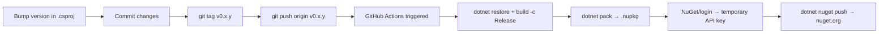

# Publishing to NuGet

ZLogger.Scintilla is published automatically via GitHub Actions when a version tag is pushed. This document describes the full release workflow.

---

## Prerequisites

- Write access to the repository
- A Trusted Publishing policy on nuget.org (once): **trgiangv → Trusted Publishing → Add**, with Repository Owner `trgiangv`, Repository `ZLogger.Scintilla`, Workflow File `publish.yml`, Environment empty. No API key is stored anywhere: the workflow trades a GitHub OIDC token for a key that lives one hour
- All changes committed and pushed to `main`
- Tests passing on `main`

---

## Release Workflow



---

## Step-by-Step

### 1. Bump the version

Edit `ZLogger.Scintilla/ZLogger.Scintilla.csproj`:

```xml
<Version>0.0.4</Version>
```

### 2. Update CHANGELOG.md

Add a new section at the top of `CHANGELOG.md` following the existing format:

```markdown
## [0.0.4] — 2026-MM-DD

### Added
- ...

### Changed
- ...

### Fixed
- ...
```

### 3. Commit

```bash
git add ZLogger.Scintilla/ZLogger.Scintilla.csproj CHANGELOG.md
git commit -m "chore: release v0.0.4"
```

### 4. Create and push the tag

```bash
git tag v0.0.4
git push origin main
git push origin v0.0.4
```

> The tag push triggers `.github/workflows/publish.yml`, which runs on `windows-latest`.

### 5. Verify the publish

- Check the [Actions tab](../../actions) for the workflow run
- Confirm the package appears on [nuget.org/packages/ZLogger.Scintilla](https://www.nuget.org/packages/ZLogger.Scintilla)

---

## GitHub Actions Workflow

The workflow file is at `.github/workflows/publish.yml`:

```yaml
on:
  push:
    tags:
      - 'v*'
  workflow_dispatch:
```

A tag push publishes that tag. **Run workflow** (`workflow_dispatch`) publishes the version in the `.csproj` of the chosen branch, which re-publishes a release whose tag predates a workflow fix.

Steps executed, with `id-token: write` permission:
1. `actions/checkout@v4` with `submodules: recursive` — required for LookupEngine submodule
2. `dotnet restore` on the main project
3. `dotnet build -c Release` — compiles the LookupEngine source into `ZLogger.Scintilla.dll`
4. `dotnet pack -c Release --no-build` — packages the assembly
5. `NuGet/login@v1` with `user: trgiangv` — exchanges the job's OIDC token for a one-hour API key
6. `dotnet nuget push` with that key and `--skip-duplicate` — idempotent; safe to re-run if the version already exists on NuGet

---

## Version Conventions

| Version | Meaning |
|---------|---------|
| `0.0.x` | Patch — bug fixes, docs, minor improvements |
| `0.x.0` | Minor — new features, non-breaking API additions |
| `x.0.0` | Major — breaking API changes |

---

## Troubleshooting

**Workflow not triggered:**
- Verify the tag was pushed to the remote: `git ls-remote --tags origin`
- Tags must match the `v*` pattern (e.g. `v0.0.4`, not `0.0.4`)

**LookupEngine source files are missing:**
- Ensure the `external/LookupEngine` submodule is initialized: `git submodule update --init --recursive`
- Build locally with `dotnet build ZLogger.Scintilla/ZLogger.Scintilla.csproj -c Release` to reproduce

**NuGet push rejected (version already exists):**
- `--skip-duplicate` suppresses this error; the workflow will still succeed
- To publish a fix, bump to the next patch version

**`NuGet/login` fails, or the push is rejected with 401/403:**
- Check the Trusted Publishing policy on nuget.org: owner `trgiangv`, repository `ZLogger.Scintilla`, workflow file `publish.yml` (file name only), no environment
- A new policy for a private repository is only active for 7 days until its first publish; restart that window on nuget.org if it lapsed
- The job needs `permissions: id-token: write`
