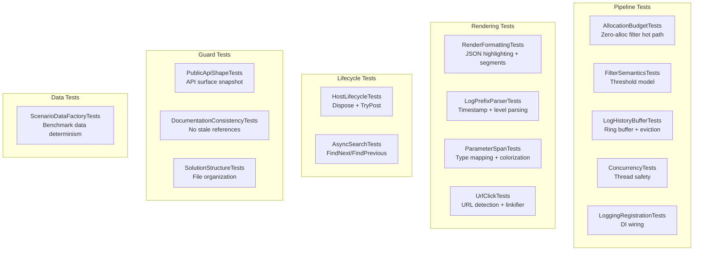

# Testing

## Running Tests

```bash
dotnet test ZLogger.Scintilla.Tests/ -c Release
```

All tests run headless — no Scintilla control or UI thread required.

**116 tests — 0 failures**

---

## Test Coverage Map



---

## Test Suite — 15 files

| File | Coverage Area |
|------|---------------|
| `AllocationBudgetTests` | `PreparedBatch` lifecycle, `PooledSegment<T>` return, zero-alloc filter path |
| `FilterSemanticsTests` | `SetFilter(LogLevel)` threshold model, edge cases (Trace=All, None=None) |
| `LogHistoryBufferTests` | Enqueue, eviction at capacity, `CaptureSnapshot` with filter, cancellation |
| `ConcurrencyTests` | `_filterVersion` monotonicity under 100 concurrent `SetFilter` calls |
| `LoggingRegistrationTests` | `ScintillaLogProcessor` uses delegate, decoupled from viewer |
| `RenderFormattingTests` | `JsonSyntaxHighlighter` styling (keys, numbers, booleans, null, punctuation) |
| `LogPrefixParserTests` | Prefix parsing `[HH:mm:ss.fff LVL] [Cat]`, level → `SemanticStyle` |
| `ParameterSpanTests` | `MapClrType`, `IsLeafType`, `HasParameter`, `DisplayValueFormatter` colorization |
| `UrlClickTests` | URL detection, `ILinkifier` contract, click action invocation |
| `HostLifecycleTests` | Double-dispose idempotency, `TryPost` after dispose returns `false` |
| `AsyncSearchTests` | `FindNextAsync` / `FindPreviousAsync` non-blocking, cancellation |
| `PublicApiShapeTests` | Exact public member set of `ScintillaLogViewerBase` + 3 interfaces |
| `DocumentationConsistencyTests` | Docs don't reference deleted types |
| `SolutionStructureTests` | File/folder organization validation |
| `ScenarioDataFactoryTests` | Benchmark data factory seed reproducibility |

---

## Key Test Contracts

### Allocation Budget

The filter hot path must not allocate a new `List<LogEntry>` per batch. `ScintillaLogViewerBase` pre-allocates `_filterBuffer` and reuses it every drain cycle. This test acts as a CI allocation gate.

### API Shape

Asserts the exact public member set of `ScintillaLogViewerBase`, `IScintillaTheme`, `ILogColorizer`, and `ILinkifier`. Prevents accidental API surface changes.

### Documentation Consistency

Scans `docs/architecture.md` and `README.md` for references to deleted types (`LogFilterState`, `LogFilterOptions`, `LogFilterSpec`, etc.) and removed API patterns (`SetFilter(string`). Fails if any stale reference is found.

### Filter Semantics

Verifies threshold model: `LogLevel.Warning` shows Warning + Error + Critical (not just Warning). `LogLevel.Trace` = all, `LogLevel.None` = nothing.

### Concurrency

100 concurrent `SetFilter` calls — `_filterVersion` must be monotonically increasing.

### Lifecycle

- `Dispose()` called twice does not throw
- `TryPost()` after dispose returns `false` (not `ObjectDisposedException`)

---

## Adding New Tests

Tests live in `ZLogger.Scintilla.Tests/`. The project uses `xUnit`.

For tests that need a viewer without a real Scintilla control, create a `ScintillaLogViewer` instance directly — the base class handles all pipeline logic internally.
