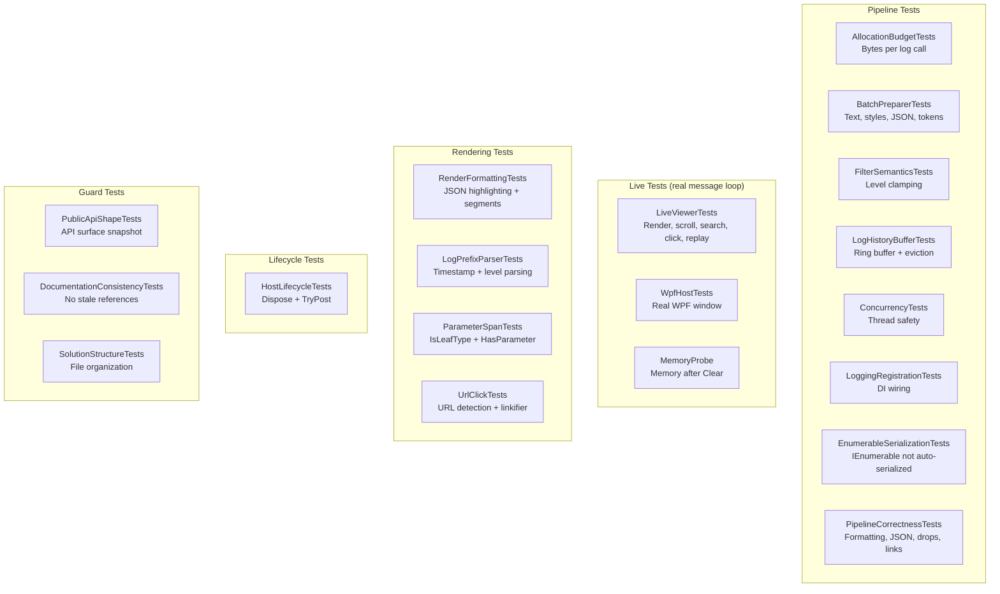

# Testing

## Running Tests

```bash
dotnet test --project ZLogger.Scintilla.Tests -c Release
```

**198 test cases across 19 test classes, run on `net48` and `net8.0-windows` — 0 failures.** Each target takes about a minute and opens windows, which do not take focus. Use `-f net48` or `-f net8.0-windows` to run one.

Tests that depend on the UI use `LiveViewer`: a real viewer in a visible window, with `Application.Run` pumping messages on its own STA thread. The test thread stays free, so a hung UI thread fails the test instead of hanging the run.

---

## Test Coverage Map



---

## Test Suite — 19 test classes

Counts include data rows.

| File | Tests | Coverage Area |
|------|-------|---------------|
| `AllocationBudgetTests` | 4 | Bytes the processor adds to ZLogger's own cost per log call, on the application's thread, and a `PreparedBatch` that owns no buffers |
| `BatchPreparerTests` | 10 | `BatchPreparer.Prepare` — text bytes, style ranges, JSON block, token ranges |
| `ConcurrencyTests` | 4 | Concurrent posting and rapid `SetFilter`, with no window |
| `DocumentationConsistencyTests` | 2 | All docs scanned for stale type/API references |
| `EnumerableSerializationTests` | 7 | `IEnumerable<T>` parameters not auto-serialized by ZLogger |
| `FilterSemanticsTests` | 2 | Out-of-range filter levels are clamped to `Trace`…`None` |
| `FindBarTests` | 10 | Find bar: find in selection, match options, caret-only navigation, keys in WinForms and WPF, cursor, caret, a 550px pane |
| `HostLifecycleTests` | 7 | Double-dispose idempotency, `TryPost` after dispose returns `false` |
| `LiveViewerTests` | 47 | On a real window: rendering, auto-scroll, filter replay, search, clicks, double clicks, drags, scopes, backlog limit, skipped lines, flush timing, deferred formatting, and a colorizer that waits for the UI thread during `Clear()` and `Dispose()` |
| `LoggingRegistrationTests` | 1 | `ScintillaLogProcessor` uses delegate, decoupled from viewer |
| `LogHistoryBufferTests` | 9 | Enqueue, eviction at capacity, chunked snapshot with filter |
| `LogPrefixParserTests` | 9 | Prefix parsing `[HH:mm:ss LVL] [Cat]` (seconds + milliseconds), level → `SemanticStyle` |
| `MemoryProbe` | 1 | Prints memory at each step around `Clear()`, and asserts that a full GC reclaims it |
| `ParameterSpanTests` | 24 | `IsLeafType`, `HasParameter` type-based lookup |
| `PipelineCorrectnessTests` | 29 | What may be deferred, drop accounting, local time, format specifiers, throwing `ToString`, a `ToString` that logs, custom serializers, JSON text, URL schemes, pooled array clearing |
| `PublicApiShapeTests` | 8 | Exact public member set of `ScintillaLogViewerBase` + 3 interfaces |
| `RenderFormattingTests` | 10 | `JsonSyntaxHighlighter` styling (keys, numbers, booleans, null, punctuation) |
| `SolutionStructureTests` | 4 | File/folder organization, required docs, minimum file count |
| `UrlClickTests` | 18 | URL detection in UTF-8 text, safe schemes, links in messages and JSON |
| `WpfHostTests` | 1 | Render, filter and search inside a real WPF window with its own `Dispatcher` |
| `LiveViewer`, `TestHelper` | — | The real-window host, and the shared `MakeEntry` factory (not test classes) |

### Package smoke test

Not part of the suite, because it needs a package feed. It verifies that a consumer of the NuGet package can run, which no project reference can show:

1. `dotnet pack ZLogger.Scintilla/ZLogger.Scintilla.csproj -c Release -o <feed> -p:Version=<test version>`
2. Outside this repository, create an app targeting `net48`, `net8.0-windows` and `net10.0-windows` that references that version from `<feed>`, with its own `globalPackagesFolder` so that nothing stale is reused.
3. In each target: register with `AddZLoggerScintillaWinForms`, log a line, and check that it reaches `ScintillaControl.Text`.

---

## Key Test Contracts

### Allocation Budget

Measures the bytes one log call allocates on the application's thread, with `GC.GetAllocatedBytesForCurrentThread`, and fails above a budget: 280 B for an interpolated call and 520 B for a template, which includes what Microsoft.Extensions.Logging itself allocates. Also checks `PreparedBatch`'s pooled arrays.

### API Shape

Asserts the exact public member set of `ScintillaLogViewerBase`, `IScintillaTheme`, `ILogColorizer`, and `ILinkifier`. Prevents accidental API surface changes.

### Documentation Consistency

Scans all docs (`docs/architecture.md`, `docs/usage.md`, `docs/benchmarks.md`, `docs/testing.md`, `README.md`) for references to deleted types and removed API patterns. Fails if any stale reference is found.

### Filter Semantics

Out-of-range levels are clamped to `Trace`…`None`. The threshold model itself (`LogLevel.Warning` shows Warning, Error and Critical) is checked on what reaches the document, by `LiveViewerTests` and `WpfHostTests`.

### Concurrency

Rapid `SetFilter` calls and posting from several threads must not throw, and `_documentEpoch` must advance. These tests have no message loop. `LiveViewerTests` covers the same pressure with a running UI thread, and checks what reaches the document.

### Lifecycle

- `Dispose()` called twice does not throw
- `TryPost()` after dispose returns `false` (not `ObjectDisposedException`)

### Enumerable Serialization (new in v0.0.3)

Verifies that `IEnumerable<T>` parameters (e.g. `List<int>`, `string[]`, `List<CustomType>`) are **not** auto-serialized to JSON by ZLogger's default formatter. ZLogger internally calls `JsonSerializer.Serialize` for non-`IFormattable` `IEnumerable` types. `ScintillaLogFormatter` detects those values and formats the message parameter by parameter instead, printing them with `value.ToString()`.

Key cases covered:

| Test | What it verifies |
|------|-----------------|
| `Processor_ListOfInts_MessageDoesNotContainAutoSerializedJson` | `[1,2,3]` not in message text |
| `Processor_ListOfStrings_MessageDoesNotContainAutoSerializedJson` | `["alpha","beta"]` not in message text |
| `Processor_Array_MessageDoesNotContainAutoSerializedJson` | `["x","y"]` not in message text |
| `Processor_PlainStringParameter_NotTreatedAsEnumerable` | Plain string still appears verbatim |
| `Processor_ParameterSpans_FormattedValueUsesToString` | `ParameterSpan.FormattedValue` equals `list.ToString()` |
| `Processor_ParameterSpans_FormattedValueMatchesMessageText` | Span value is present in the raw message bytes |
| `Processor_ListOfCustomObjects_MessageDoesNotContainAutoSerializedJson` | No `{...}` JSON for custom types |
| `Processor_ListOfCustomObjects_NoAutoSerializedJson` | Assertion with diagnostic message |

### Prefix Parsing (updated in v0.0.3)

`LogPrefixParser` now handles both the default `[HH:mm:ss LVL]` (seconds precision) and the legacy `[HH:mm:ss.fff LVL]` (milliseconds) format. Both are tested:

```
[12:34:56 INF] some message      → PrefixByteLength = 15
[12:34:56.789 INF] some message  → PrefixByteLength = 19
```

### URL Click Tests

`UrlClickTests` covers URL detection in UTF-8 text, refusing unsafe schemes, a number inside a URL not splitting the link, and URLs in messages with no parameters and in JSON strings. `LiveViewerTests` covers real clicks, double clicks and drags.

---

## Adding New Tests

Tests live in `ZLogger.Scintilla.Tests/`. The project uses `MSTest` on Microsoft.Testing.Platform.

Use `TestHelper.MakeEntry(text, level)` or `TestHelper.MakeEntry(text, level, properties)` to create `LogEntry` instances without a real ZLogger pipeline.

For integration-style tests that need a real `ScintillaLogProcessor`, use the pattern from `EnumerableSerializationTests.CaptureLogEntry`:

```csharp
var processor = new ScintillaLogProcessor(entry =>
{
    captured = entry;
    return true;
});
using var factory = LoggerFactory.Create(builder =>
{
    builder.SetMinimumLevel(LogLevel.Trace);
    builder.AddZLoggerLogProcessor(processor);
});
```

For tests of rendering, scrolling, search or anything else that needs the UI thread, use `LiveViewer`:

```csharp
using var live = new LiveViewer(o => o.Display(maxLines: 100));
live.Logger.LogInformation("hello {V}", 1);
live.WaitForLine("hello 1");
Assert.IsTrue(live.TailVisible());
```

Run anything that touches the control through `live.Ui(...)`. For tests of pipeline logic with no window, create a `ScintillaLogViewer` directly, but nothing renders without a message loop.
