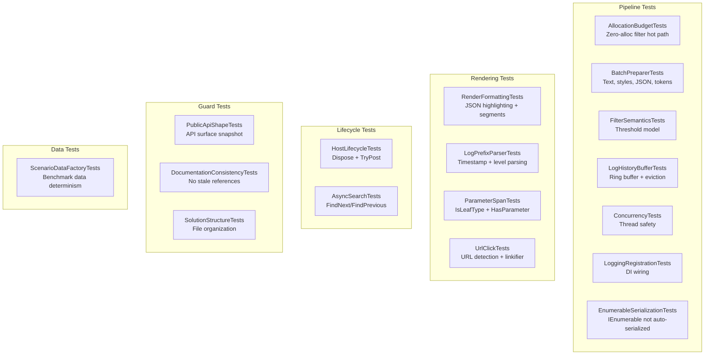

# Testing

## Running Tests

```bash
dotnet test ZLogger.Scintilla.Tests/ -c Release
```

All tests run headless — no Scintilla control or UI thread required.

**~136 test cases across 17 files — 0 failures**

---

## Test Coverage Map



---

## Test Suite — 17 files

| File | Tests | Coverage Area |
|------|-------|---------------|
| `AllocationBudgetTests` | 3 | `PreparedBatch` lifecycle, `PooledSegment<T>` return, zero-alloc filter path |
| `AsyncSearchTests` | 2 | `FindNextAsync` / `FindPreviousAsync` non-blocking, cancellation |
| `BatchPreparerTests` | 10 | `BatchPreparer.Prepare` — text bytes, style ranges, JSON block, token ranges |
| `ConcurrencyTests` | 4 | `_filterVersion` monotonicity under 100 concurrent `SetFilter` calls |
| `DocumentationConsistencyTests` | 5 | All docs scanned for stale type/API references |
| `EnumerableSerializationTests` | 9 | `IEnumerable<T>` parameters not auto-serialized by ZLogger; `ScintillaLogFormatter` overrides user-configured formatter |
| `FilterSemanticsTests` | 5 | `SetFilter(LogLevel)` threshold model, edge cases (Trace=All, None=None) |
| `HostLifecycleTests` | 7 | Double-dispose idempotency, `TryPost` after dispose returns `false` |
| `LoggingRegistrationTests` | 1 | `ScintillaLogProcessor` uses delegate, decoupled from viewer |
| `LogHistoryBufferTests` | 11 | Enqueue, eviction at capacity, `CaptureSnapshot` with filter, cancellation |
| `LogPrefixParserTests` | 4 | Prefix parsing `[HH:mm:ss LVL] [Cat]` (seconds + milliseconds), level → `SemanticStyle` |
| `ParameterSpanTests` | 11 | `IsLeafType`, `HasParameter` type-based lookup |
| `PublicApiShapeTests` | 8 | Exact public member set of `ScintillaLogViewerBase` + 3 interfaces |
| `RenderFormattingTests` | 10 | `JsonSyntaxHighlighter` styling (keys, numbers, booleans, null, punctuation) |
| `ScenarioDataFactoryTests` | 2 | Benchmark data factory seed reproducibility |
| `SolutionStructureTests` | 4 | File/folder organization, required docs, minimum file count |
| `TestHelper` | — | Shared `MakeEntry` factory (not a test class) |

---

## Key Test Contracts

### Allocation Budget

The filter hot path must not allocate a new `List<LogEntry>` per batch. `ScintillaLogViewerBase` pre-allocates `_filterBuffer` and reuses it every drain cycle. This test acts as a CI allocation gate.

### API Shape

Asserts the exact public member set of `ScintillaLogViewerBase`, `IScintillaTheme`, `ILogColorizer`, and `ILinkifier`. Prevents accidental API surface changes.

### Documentation Consistency

Scans all docs (`docs/architecture.md`, `docs/usage.md`, `docs/benchmarks.md`, `docs/testing.md`, `README.md`) for references to deleted types and removed API patterns. Fails if any stale reference is found.

### Filter Semantics

Verifies threshold model: `LogLevel.Warning` shows Warning + Error + Critical (not just Warning). `LogLevel.Trace` = all, `LogLevel.None` = nothing.

### Concurrency

100 concurrent `SetFilter` calls — `_filterVersion` must be monotonically increasing.

### Lifecycle

- `Dispose()` called twice does not throw
- `TryPost()` after dispose returns `false` (not `ObjectDisposedException`)

### Enumerable Serialization (new in v0.0.3)

Verifies that `IEnumerable<T>` parameters (e.g. `List<int>`, `string[]`, `List<CustomType>`) are **not** auto-serialized to JSON by ZLogger's default formatter. ZLogger internally calls `JsonSerializer.Serialize` for non-`IFormattable` `IEnumerable` types; `ScintillaLogFormatter` bypasses this by calling `value.ToString()` directly via `RenderingChars.FormatParameterValue`.

Key cases covered:

| Test | What it verifies |
|------|-----------------|
| `Processor_ListOfInts_MessageDoesNotContainAutoSerializedJson` | `[1,2,3]` not in message text |
| `Processor_ListOfStrings_MessageDoesNotContainAutoSerializedJson` | `["alpha","beta"]` not in message text |
| `Processor_Array_MessageDoesNotContainAutoSerializedJson` | `["x","y"]` not in message text |
| `Processor_PlainStringParameter_NotTreatedAsEnumerable` | Plain string still appears verbatim |
| `Processor_ParameterSpans_FormattedValueUsesToString` | `ParameterSpan.FormattedValue` equals `list.ToString()` |
| `Processor_ParameterSpans_FormattedValueMatchesMessageText` | Span value is present in the raw message bytes |
| `Processor_ListOfCustomObjects_MessageDoesNotContainAutoSerializedJson` | No `{...}` JSON for custom types |
| `Processor_ListOfCustomObjects_NoAutoSerializedJson` | Assertion with diagnostic message |

### Prefix Parsing (updated in v0.0.3)

`LogPrefixParser` now handles both the default `[HH:mm:ss LVL]` (seconds precision) and the legacy `[HH:mm:ss.fff LVL]` (milliseconds) format. Both are tested:

```
[12:34:56 INF] some message      → PrefixByteLength = 15
[12:34:56.789 INF] some message  → PrefixByteLength = 19
```

### URL Click Tests (expanded in v0.0.3)

`UrlClickTests` now covers:
- `EmitUrlOrFallback` with `preserveStyle: true` for URLs inside JSON string values
- `HasPotentialCandidate` fast-path (theory: positive + negative cases)
- `FindAll` returning correct match count for multiple URLs
- `TryNormalizeUri` valid and invalid URL handling

---

## Adding New Tests

Tests live in `ZLogger.Scintilla.Tests/`. The project uses `xUnit`.

Use `TestHelper.MakeEntry(text, level)` or `TestHelper.MakeEntry(text, level, properties)` to create `LogEntry` instances without a real ZLogger pipeline.

For integration-style tests that need a real `ScintillaLogProcessor`, use the pattern from `EnumerableSerializationTests.CaptureLogEntry`:

```csharp
var processor = new ScintillaLogProcessor(entry =>
{
    captured = entry;
    return true;
});
using var factory = LoggerFactory.Create(builder =>
{
    builder.SetMinimumLevel(LogLevel.Trace);
    builder.AddZLoggerLogProcessor(processor);
});
```

For tests that need a viewer without a real Scintilla control, create a `ScintillaLogViewer` instance directly — the base class handles all pipeline logic internally.
