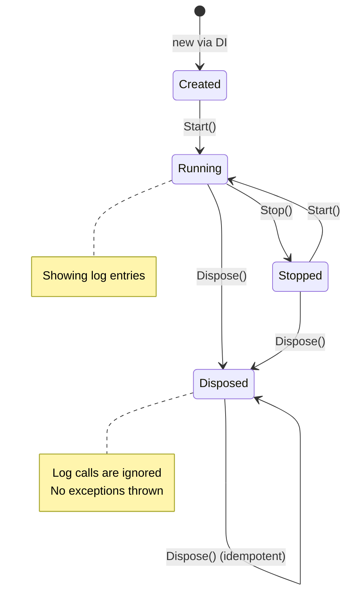
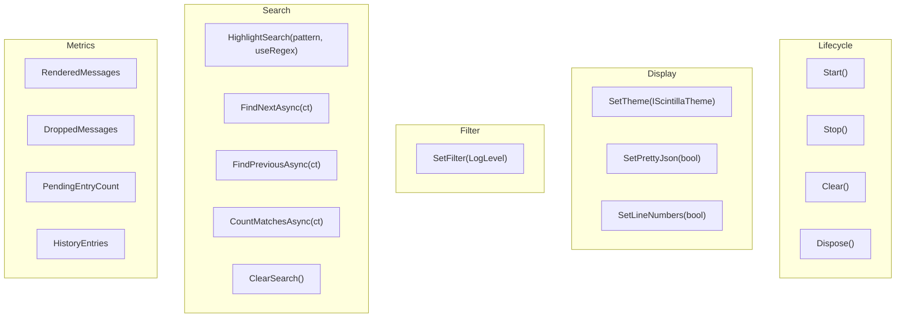
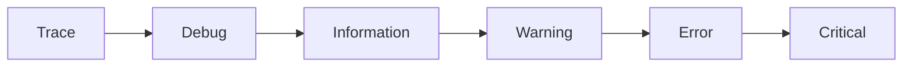
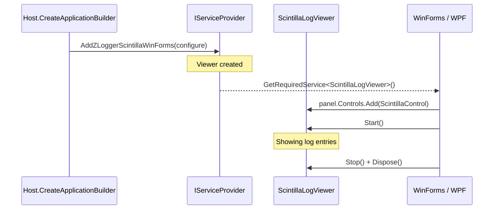

# Usage Guide

## Registration

`AddZLoggerScintillaWinForms` or `AddZLoggerScintillaWpf` creates the viewer and registers it in DI, as its own type and as `ScintillaLogViewerBase`. Register on the UI thread: Scintilla creates its window handle when the viewer is constructed, and that handle belongs to the constructing thread.

### WinForms

```csharp
services.AddLogging(logging =>
    logging.AddZLoggerScintillaWinForms(
        v => v
            .Display(maxLines: 50_000, font: "Cascadia Mono", fontSize: 10)
            .SetTheme(ScintillaThemes.Dark)
            .WithColorized(new MyColorizer())
            .WithLinkify(new MyLinkifier())
    )
);

var viewer = host.Services.GetRequiredService<ScintillaLogViewer>();
panel.Controls.Add(viewer.ScintillaControl);
viewer.Start();
```

### WPF

```csharp
services.AddLogging(logging =>
    logging.AddZLoggerScintillaWpf(
        v => v.SetTheme(ScintillaThemes.Dark)
    )
);

var viewer = host.Services.GetRequiredService<ScintillaLogViewerWpf>();
hostGrid.Children.Add((UIElement)viewer.HostElement);
viewer.Start();
```

### Platform-agnostic

```csharp
var viewer = host.Services.GetRequiredService<ScintillaLogViewerBase>();
```

---

## Lifecycle



---

## Runtime API



### Filter — Threshold Model



`SetFilter(LogLevel.Warning)` → shows Warning + Error + Critical (everything ≥ Warning). The filter also applies to lines already shown, rebuilt from the history (see `.History` below).

| Call | Entries shown |
|------|---------------|
| `SetFilter(LogLevel.Trace)` | All |
| `SetFilter(LogLevel.Debug)` | Debug → Critical |
| `SetFilter(LogLevel.Warning)` | Warning → Critical |
| `SetFilter(LogLevel.None)` | Nothing |

### Search

```csharp
viewer.HighlightSearch("error");                    // highlight all matches
viewer.HighlightSearch(@"ERR\d+", useRegex: true);  // regex, see the note below
var pos = await viewer.FindNextAsync();              // SearchPosition { Current, Total }
var pos = await viewer.FindPreviousAsync();
int count = await viewer.CountMatchesAsync();
viewer.ClearSearch();
```

Regular expressions use the ECMAScript grammar of Scintilla's C++11 engine, for navigation, highlighting and counting alike, and `^` and `$` match at line boundaries. An invalid pattern finds nothing.

### Auto-scroll

With `autoScroll` on, the view follows new lines until the user scrolls away from the end, or a search moves to a match above it. New lines then leave the view alone. Scrolling back to the end resumes following.

### Metrics

```csharp
long rendered = viewer.RenderedMessages;  // entries shown so far. Re-filtering shows them again and counts them again
long dropped  = viewer.DroppedMessages;   // entries discarded because the queue was full
long pending  = viewer.PendingEntryCount; // entries waiting to be shown
long history  = viewer.HistoryEntries;    // entries kept for re-filtering
```

When the UI cannot keep up, entries wait in a queue of `capacity` entries. Once it is full, `dropPolicy` decides: the default `DropWrite` discards new entries and counts them in `DroppedMessages`, so a log call never waits. `Wait` makes the log call wait instead.

---

## Builder Options

`ScintillaOptions` — fluent configuration at startup (immutable after construction):

| Method | Default | Description |
|--------|---------|-------------|
| `.Channel(capacity, flushMs, maxBatch, dropPolicy)` | 100000 / 75ms / 2000 / DropWrite | Queue size, how often lines are shown, how many at once, and what happens when the queue is full |
| `.Display(maxLines, font, fontSize, autoScroll)` | 50000 / Cascadia Mono / 10 / true | Lines kept on screen, font, auto-scroll |
| `.History(maxEntries, disabled)` | 50000 / false | Entries kept for `SetFilter` and `SetPrettyJson` to re-render. With history disabled, both apply to new lines only |
| `.WithScopes(enabled)` | false | Make `BeginScope` values available to linkifiers through `RenderContext.Properties`. Costs every log call |
| `.SetTheme(IScintillaTheme)` | `ScintillaThemes.Dark` | Initial color theme |
| `.WithColorized(ILogColorizer)` | null | Token-level color override |
| `.WithLinkify(ILinkifier)` | null | Clickable token handler |
| `.WithEnrichmentErrorSink(Action<Exception>)` | null | Receives exceptions from colorizers, linkifiers and formatting. An entry that fails to style is still shown as plain text |

---

## Extension Points

Each token is offered to the linkifier first. A token it matches becomes a link; any other token is offered to the colorizer.

### IScintillaTheme

Custom color theme — implement all 18 color properties. See `ScintillaThemes.Dark` / `ScintillaThemes.Light` for reference.

### ILogColorizer

Override token foreground colors. Called on a **background thread**, so it must be thread-safe. It may wait for the UI thread, though every wait slows rendering.

See `Public/ILogColorizer.cs` for the contract signature.

### ILinkifier

Make tokens clickable. Receives `RenderContext`, which tells you which log parameter a token came from: `ParameterSpan.HasParameter(context, clrTypeFullName, formattedValue)`. Called on a **background thread**, so it must be thread-safe. It may wait for the UI thread, though every wait slows rendering.

`http` and `https` URLs in log text are clickable with or without a linkifier. Other schemes stay plain text, because a click shell-executes the link. A linkifier can make anything clickable, which keeps that decision in your own code.

See `Public/ILinkifier.cs` for the contract signature.

---

## IHost Integration



---

## Target Frameworks

`net48`, `net8.0-windows` and `net10.0-windows`, for both WinForms and WPF.
