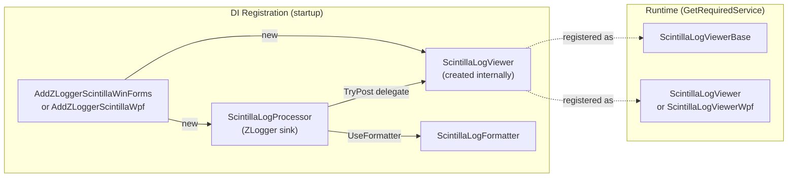
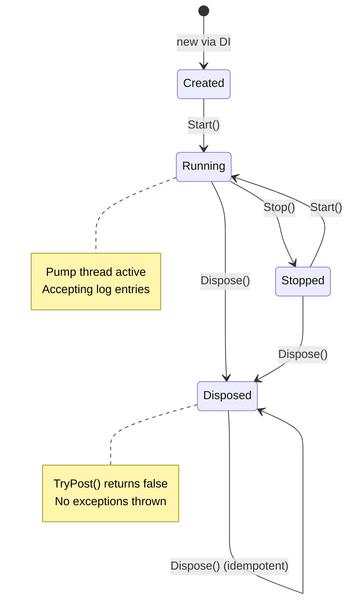
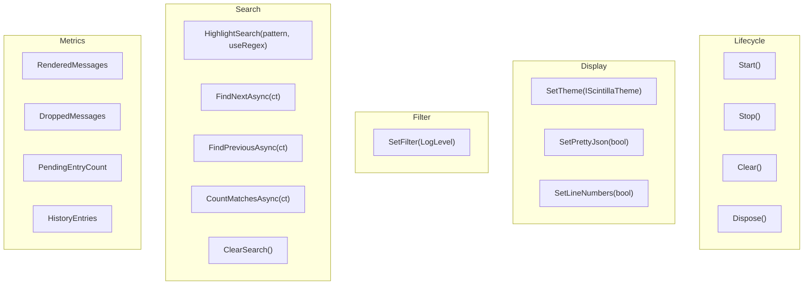
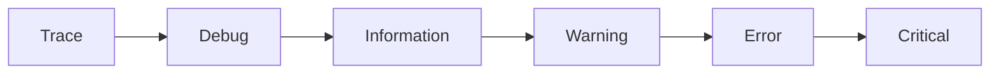
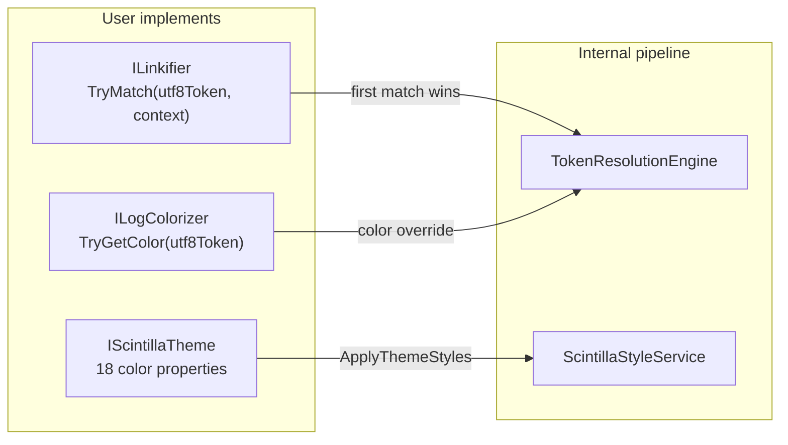
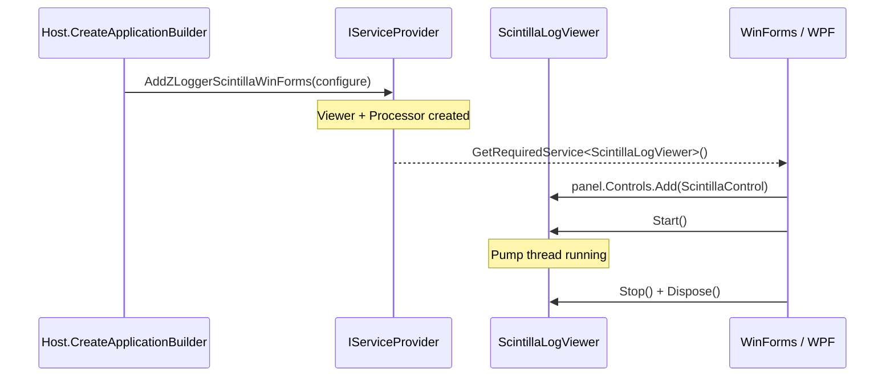

# Usage Guide

## Registration Flow



### WinForms

```csharp
services.AddLogging(logging =>
    logging.AddZLoggerScintillaWinForms(
        v => v
            .Display(maxLines: 50_000, font: "Cascadia Mono", fontSize: 10)
            .SetTheme(ScintillaThemes.Dark)
            .WithColorized(new MyColorizer())
            .WithLinkify(new MyLinkifier())
    )
);

var viewer = host.Services.GetRequiredService<ScintillaLogViewer>();
panel.Controls.Add(viewer.ScintillaControl);
viewer.Start();
```

### WPF

```csharp
services.AddLogging(logging =>
    logging.AddZLoggerScintillaWpf(
        v => v.SetTheme(ScintillaThemes.Dark)
    )
);

var viewer = host.Services.GetRequiredService<ScintillaLogViewerWpf>();
hostGrid.Children.Add((UIElement)viewer.HostElement);
viewer.Start();
```

### Platform-agnostic

```csharp
var viewer = host.Services.GetRequiredService<ScintillaLogViewerBase>();
```

---

## Lifecycle



---

## Runtime API



### Filter — Threshold Model



`SetFilter(LogLevel.Warning)` → shows Warning + Error + Critical (everything ≥ Warning).

| Call | Entries shown |
|------|---------------|
| `SetFilter(LogLevel.Trace)` | All |
| `SetFilter(LogLevel.Debug)` | Debug → Critical |
| `SetFilter(LogLevel.Warning)` | Warning → Critical |
| `SetFilter(LogLevel.None)` | Nothing |

### Search

```csharp
viewer.HighlightSearch("error");                    // highlight all matches
viewer.HighlightSearch(@"\bERR\b", useRegex: true); // regex support
var pos = await viewer.FindNextAsync();              // SearchPosition { Current, Total }
var pos = await viewer.FindPreviousAsync();
int count = await viewer.CountMatchesAsync();
viewer.ClearSearch();
```

### Metrics

```csharp
long rendered = viewer.RenderedMessages;  // total entries rendered to UI
long dropped  = viewer.DroppedMessages;   // entries dropped by backpressure
long pending  = viewer.PendingEntryCount; // entries waiting in channel
long history  = viewer.HistoryEntries;    // entries in history buffer
```

---

## Builder Options

`ScintillaOptions` — fluent configuration at startup (immutable after construction):

| Method | Default | Description |
|--------|---------|-------------|
| `.Channel(capacity, flushMs, maxBatch, dropPolicy)` | 20000 / 75ms / 500 / DropWrite | Ingest channel tuning |
| `.Display(maxLines, font, fontSize, autoScroll)` | 50000 / Cascadia Mono / 10 / true | Display limits |
| `.History(maxEntries, disabled)` | 50000 / false | History buffer for filter reapply |
| `.SetTheme(IScintillaTheme)` | `ScintillaThemes.Dark` | Initial color theme |
| `.WithColorized(ILogColorizer)` | null | Token-level color override |
| `.WithLinkify(ILinkifier)` | null | Clickable token handler |
| `.WithEnrichmentErrorSink(Action<Exception>)` | null | Sink for colorizer/linkifier errors |

---

## Extension Points



### IScintillaTheme

Custom color theme — implement all 18 color properties. See `ScintillaThemes.Dark` / `ScintillaThemes.Light` for reference.

### ILogColorizer

Override token foreground colors. Called on the **pump thread** — must be thread-safe.

See `Public/ILogColorizer.cs` for the contract signature.

### ILinkifier

Make tokens clickable. Receives `RenderContext` with typed parameter metadata via `ParameterSpan.HasParameter(context, clrTypeFullName, formattedValue)`. Called on the **pump thread** — must be thread-safe.

See `Public/ILinkifier.cs` for the contract signature.

---

## IHost Integration



---

## Target Frameworks

- `net48` — WinForms / WPF legacy
- `net8.0-windows` — WinForms / WPF modern

## Dependencies

| Package | Purpose |
|---------|---------|
| `Scintilla5.NET` | Editor engine |
| `ZLogger` | Structured logging source |
| `Microsoft.Extensions.Logging` | `ILogger` / `IHost` integration |
| `System.Threading.Channels` | Bounded ingest queue |
| [LookupEngine](https://github.com/lookup-foundation/LookupEngine) | Object decomposition for pretty JSON (bundled via ILRepack) |

> **Note:** `LookupEngine` is included as a git submodule under `external/LookupEngine` and merged into `ZLogger.Scintilla.dll` at build time using ILRepack. The NuGet package ships a single assembly with no external LookupEngine dependency.
